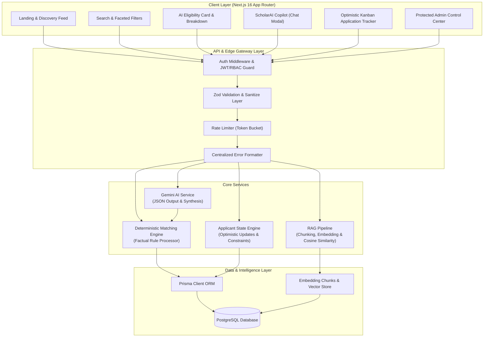

# ScholarAI — AI-Powered Scholarship Discovery & Eligibility Platform

ScholarAI is a production-style full-stack web application that helps students discover international scholarships, deterministically evaluate eligibility requirements without hallucinations, converse with a grounded RAG scholarship assistant, and track application milestones with optimistic updates.

---

## 1. System Architecture



---

## 2. Key Features

- **Deterministic Rule-Based Matching Engine**: Factual decisions (GPA minimums, degree levels, course disciplines, nationality restrictions, language tests) are evaluated mathematically with zero LLM hallucination. Missing profile data is explicitly treated as `MISSING_INFO`.
- **Gemini AI Synthesis**: Google Gemini (`gemini-2.5-flash`) formats deterministic calculations into encouraging, clear explanations and concrete next steps.
- **RAG-Based Scholarship Assistant**: Ingests official program guidelines, extracts and chunks text, computes 768-dim embeddings via `text-embedding-004`, and retrieves relevant evidence via cosine similarity and keyword boosting.
- **Optimistic Application Tracking**: Supports statuses (`Interested`, `Preparing Documents`, `Ready to Apply`, `Submitted`, `Under Review`, `Approved`, `Rejected`), inline milestone notes, upcoming deadline alerts, and automatic state rollback on failure.
- **Role-Based Access Control & Admin Console**: Administrative dashboard to ingest official documents, trigger re-indexing, moderate verification badges, and archive programs.
- **Token-Bucket Rate Limiter**: Prevents abuse and protects AI endpoints from quota exhaustion with dynamic retry headers.

---

## 3. Technology Stack

- **Frontend**: Next.js 16 (App Router), React 19, TypeScript, Tailwind CSS, Lucide Icons, Sonner toasts.
- **Backend**: Next.js Server Route Handlers, REST API architecture, Zod schema validation, centralized error handling.
- **Database & ORM**: PostgreSQL, Prisma Client 6, versioned migrations, relational constraints.
- **AI & RAG**: Google Gemini API (`gemini-2.5-flash`), `text-embedding-004`, token-aware sentence chunker, cosine similarity ranking.
- **Security**: `bcryptjs` password hashing, `jose` JWT signing & verification, HTTP-only secure cookies, RBAC route guards.

---

## 4. Getting Started

### Prerequisites
- Node.js 20+ installed
- PostgreSQL database instance (Supabase, Neon, AWS RDS, or local Docker)
- Google Gemini API key ([Google AI Studio](https://aistudio.google.com/))

### Installation
```bash
# Clone repository
git clone https://github.com/your-username/scholar-ai.git
cd scholar-ai

# Install dependencies
npm install

# Configure environment variables
cp .env.example .env
# Edit .env with your DATABASE_URL and GEMINI_API_KEY
```

### Database Setup & Seeding
```bash
# Push Prisma schema to PostgreSQL
npx prisma db push

# Generate Prisma Client
npx prisma generate

# Seed sample international scholarships and official documents
npm run seed  # or npx tsx prisma/seed.ts
```

### Run Development Server
```bash
npm run dev
```
Open [http://localhost:3000](http://localhost:3000) in your browser.

---

## 5. Automated Testing

Run the automated test suite covering deterministic matching rules, missing data handling, GPA normalization, RAG chunking, vector cosine similarity, and Zod schema validations:

```bash
# Run unit & logic tests
npx tsx tests/unit-tests.ts
```

### Postman API Testing
Import `tests/scholar-ai.postman_collection.json` into Postman to test all 14 REST endpoints.

---

## 6. REST API Endpoints

| Method | Endpoint | Description | Auth Required |
|---|---|---|---|
| `POST` | `/api/auth/register` | Register student or admin account | Public |
| `POST` | `/api/auth/login` | Authenticate and obtain JWT | Public |
| `GET` | `/api/auth/me` | Fetch active session | Authenticated |
| `POST` | `/api/auth/logout` | Clear auth cookies | Authenticated |
| `GET` | `/api/profile` | Retrieve student profile | Authenticated (Owner) |
| `PUT` | `/api/profile` | Upsert student profile | Authenticated (Owner) |
| `GET` | `/api/scholarships` | Faceted search, filter & paginate | Public |
| `GET` | `/api/scholarships/:id` | Fetch single scholarship details | Public |
| `POST` | `/api/scholarships` | Create new scholarship | Admin Only |
| `POST` | `/api/matches` | Evaluate deterministic + AI match | Authenticated |
| `GET` | `/api/matches` | Retrieve saved student matches | Authenticated |
| `POST` | `/api/assistant` | Query RAG conversational assistant | Public / Authenticated |
| `GET` | `/api/saved-scholarships` | List bookmarked scholarships | Authenticated |
| `POST` | `/api/saved-scholarships` | Save scholarship bookmark | Authenticated |
| `DELETE` | `/api/saved-scholarships/:id` | Remove saved scholarship | Authenticated |
| `GET` | `/api/applications` | List tracked applications & KPIs | Authenticated |
| `POST` | `/api/applications` | Track application (duplicate prevention) | Authenticated |
| `PATCH` | `/api/applications/:id` | Update status & personal notes | Authenticated (Owner) |
| `DELETE` | `/api/applications/:id` | Remove tracked application | Authenticated (Owner) |
| `POST` | `/api/admin/ingest` | Ingest document & generate vector chunks | Admin Only |
| `GET` | `/api/admin/scholarships` | Moderate all scholarships & documents | Admin Only |

---

## 7. Deployment Instructions

### Vercel Deployment
1. Push code to your GitHub repository.
2. Link the repository in the [Vercel Dashboard](https://vercel.com/).
3. Add the following Environment Variables in Vercel Project Settings:
   - `DATABASE_URL`: Hosted PostgreSQL connection string (Supabase pooler / Neon URL).
   - `GEMINI_API_KEY`: Google AI Studio API key.
   - `JWT_SECRET`: Random 32+ character production secret.
   - `NEXT_PUBLIC_APP_URL`: Production domain URL (e.g., `https://scholar-ai.vercel.app`).
4. Set Build Command: `prisma generate && next build`.
5. Deploy.

---

## 8. Implemented Features & Known Limitations

### Implemented
- Full relational schema with 9 models, enums, indexes, and unique constraints.
- Zero-hallucination deterministic rules engine with scale normalization.
- Grounded RAG assistant with token-aware chunking and cosine similarity scoring.
- Optimistic UI application tracker with state rollback on error.
- Role-based admin console and document ingestion interface.
- Token-bucket rate limiter.
- Automated unit test suite and Postman collection.

### Known Limitations
- When using direct Supabase connections without connection poolers, network timeouts may occur on restrictive IPv6 networks; use Supabase Session Pooler (port 6543) or Neon serverless database for best cloud performance.
- Document ingestion currently accepts raw textual transcripts or markdown; PDF binary parser worker can be added as a background job for direct PDF uploads.
